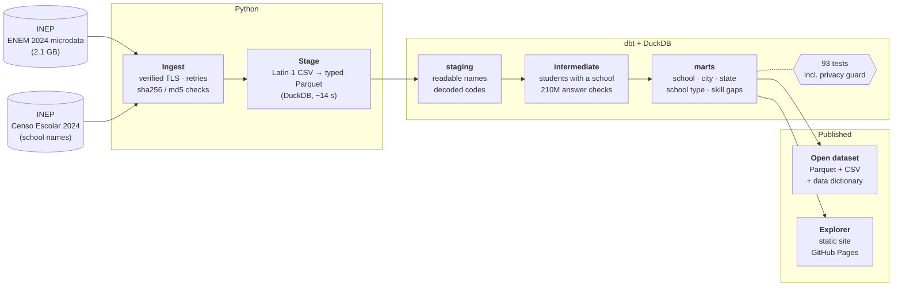

# ENEM Explorer

[](https://github.com/odavicoelho/enem-explorer/actions/workflows/ci.yml)

**🔎 Explorer: [odavicoelho.github.io/enem-explorer](https://odavicoelho.github.io/enem-explorer/)** · **📦 Open dataset: [releases](https://github.com/odavicoelho/enem-explorer/releases)**

ENEM Explorer turns INEP's raw ENEM microdata into clean, tested tables and a public explorer: how every school, city and state in Brazil did on ENEM 2024, and **which skills students miss the most**.

I've been teaching math and physics since 2018, and one question always bugged me: *which* parts of the exam do students actually get wrong? INEP publishes every answer of every student, so the data to answer that exists. It's just buried. So I built the pipeline to dig it out.

## Why this is valuable

**The problem:** ENEM data is public, but almost nobody can use it. You get 2 GB of CSVs in Latin-1 encoding, coded columns, a data dictionary in a spreadsheet, answers stored as 45-letter strings, and a certificate error on INEP's server just to download it. In practice, only researchers and big education companies use it.

That leaves a lot of people deciding things in the dark:

- **Parents choosing a school** can't easily see how it actually performs next to other schools nearby.
- **Schools** can't compare themselves with similar schools (same city, same type), or see which skills their students are missing.
- **Tutors and prep courses (cursinhos)** guess what to focus on. The data says exactly which skills are missed most, by state and by school type. I use this myself.
- **City education departments, journalists and researchers** need comparisons by city and school type without building a pipeline first.

**What ENEM Explorer gives them:** search any school and see its scores next to its city, its state and similar schools, its ranking, and the five skills where it falls furthest behind similar schools. Everything is also published as an **open dataset** (Parquet and CSV, with a data dictionary) for anyone who wants to go deeper.

## A few things the data shows

- **Private schools average 614; state schools average 505.** Federal schools (586) sit in between.
- **In math, state-school students get 24% of the questions right**, barely above guessing (20% with five options). Private-school students get 40%.
- **The most missed math skill in Brazil is H11**, using scale to read everyday representations (maps, plans, models). Only 12% of state-school students and 14% of private-school students get those questions right.
- **Santa Catarina has the best average of any state** (560). Amazonas has the lowest (487).
- **Nova Friburgo, my city, ranks 1st out of 92 cities in Rio de Janeiro.**

## The big picture



Step by step:

1. **Ingest** downloads the ENEM microdata and the school census from INEP, checks they arrived complete and records a checksum of each file.
2. **Stage** converts the CSVs to typed Parquet once. Reading the raw results CSV takes over a minute; after this step every query takes seconds.
3. **dbt** does all the transformation in SQL, in three layers:
   - **staging** renames INEP's codes into readable columns.
   - **intermediate** keeps the students who can be ranked, and unpacks every answer string.
   - **marts** are the tables people actually use.
4. **Export** publishes the marts as an open dataset, and **the explorer** is built from the same marts.

## Why I built it this way

**I verify INEP's certificate instead of turning verification off.** INEP's server forgets to send part of its certificate chain, so most tools fail with "unable to get local issuer certificate". The usual fix online is `--insecure`. I didn't want that in a data pipeline, so the repo ships the missing intermediate certificate (issued by GlobalSign, which every system already trusts) and verifies the full chain.

**Read the CSV once, then never again.** The results file is 1.7 GB of Latin-1 text. Converting it to typed Parquet with DuckDB takes about 10 seconds and makes everything after it fast. I also pin the types of the important columns, so a lucky sample can't turn a school code into text or an answer string into a number.

**dbt for the transformations.** Every step is plain SQL in version control, documented column by column, and tested. The tests check uniqueness, accepted values, score ranges, and that staging never drops a row. There's also one test I'm proud of: INEP publishes each answer key twice, once inside the results file and once in the items file, and a test proves the two agree for every booklet and position. If they didn't, the whole skill analysis would be wrong.

**Privacy is a test, not a promise.** Only averages are published, never an individual row. Any group with fewer than 10 students is suppressed, and that rule is enforced by a dbt test that fails the build. It can't be skipped by accident. Even the test data in this repo is synthetic: it has the exact same layout as INEP's files, but every value is made up.

**210 million answers, never stored.** To find which skills students miss, every student's answers get compared letter by letter with the answer key and matched to the skill each question tests. That's about 210 million checks. Storing them would be pointless, so the model is a view that DuckDB streams straight into the aggregates. The whole dbt build runs in about 17 seconds on my laptop.

**The explorer is built for phones.** It's a static site: no server and no database in the browser. The home page loads one 3 KB file. Search loads a compact index only when you tap it. Each school is its own ~2 KB file, loaded only when you open it.

**One honest limitation.** Since INEP's 2022 privacy changes, student profiles (family income, parents' education) and results are published with different IDs, so they can't be linked per student. ENEM Explorer only claims what the data actually supports.

## Run it yourself

```sh
python -m venv .venv && . .venv/bin/activate
pip install -e ".[dev]"

scripts/pipeline.sh --fixture   # whole pipeline on the synthetic sample (offline, seconds)
scripts/pipeline.sh             # the real thing: downloads ~560 MB from INEP
```

Or step by step: `enem ingest`, `enem stage`, `dbt build` (inside `dbt/`), `enem export`, `enem site`.

## The open dataset

| Table | Rows | What |
|---|---|---|
| `school` | 23,023 | Every school with 10+ students: scores, rankings, name, facilities |
| `city` | 5,197 | Every city, by where its schools are |
| `state` | 27 | Every state |
| `school_type` | 98 | Federal / state / municipal / private, per state and for Brazil |
| `skill_gaps` | 11,760 | % correct for each of the 120 skills, per state and school type |
| `school_skills` | 2.7M | % correct per skill for each school, next to similar schools |

Full column descriptions are in the release's `DATA_DICTIONARY.md`, generated from the dbt docs.

## How I keep it reliable

- **CI runs the entire pipeline on every push**, on the synthetic sample: stage → dbt build with all 93 tests → export → explorer. It's offline and fast.
- **`ruff` and `mypy --strict`** on the Python code, plus unit tests for the download, checksum and staging logic.
- **Publishing** ([publish.yml](.github/workflows/publish.yml)) is a manual workflow I run when INEP updates the data: it runs the real pipeline, attaches the dataset to a release and deploys the explorer.

## Stack

Python 3.12 · DuckDB · dbt-core + dbt-duckdb · Parquet · httpx · Typer · pytest · ruff · mypy · GitHub Actions · GitHub Pages · plain HTML/CSS/JS

---

Built by [Davi Coelho](https://davicoelho-comercial.vercel.app), software & data engineer and math/physics tutor. Data: INEP (ENEM 2024 and Censo Escolar 2024 microdata). Design notes in [ARCHITECTURE.md](ARCHITECTURE.md). MIT licensed.
